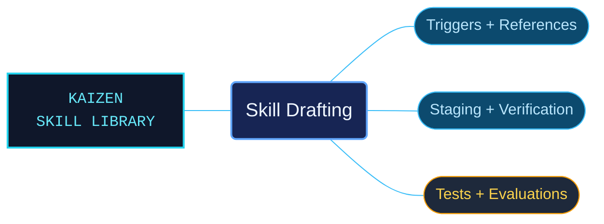

# Skill Drafting

A portable authoring and repair workflow for agent skills, supported by templates, reference guidance and Python tooling. It turns explicit author decisions into reviewable proposals and staged packages, with source preservation and deployment checks kept visible throughout the process.

Use when creating, substantially revising, repairing or reviewing agent skills; defining activation triggers and context routes; organizing source documentation into coherent references; validating skill packages; or preparing staged changes, source maps, regression tests and approved deployment. Not for writing ordinary application documentation without a skill-authoring task.

## What this skill helps with

| Task | Useful reference material |
| --- | --- |
| [Define the skill and its routes](references/authoring/index.md) | Write activation descriptions, organize subjects and preserve source meaning. |
| [Verify the package](references/verification/index.md) | Check structure, local navigation, source coverage and protected technical content. |
| [Stage and deploy reviewed changes](references/operations/index.md) | Prepare manifests, review candidates and follow deployment and recovery procedures. |
| [Evaluate authoring and skill use](references/evaluation/index.md) | Separate software regression tests from realistic agent-task evaluation. |

## The work behind the references

The authoring guidance distinguishes public Agent Skills requirements from the selected library conventions. A single Python implementation supports the staging workflow, while software fixtures and realistic skill-use cases exercise different aspects of the package.

## Start here

Start with [SKILL.md](SKILL.md) and follow its context routes.

Reading the references needs no runtime. The [tool entrypoint](scripts/skill_builder.py) requires Python 3.12+ and the [declared dependencies](scripts/requirements.txt). Read [portable commands](references/operations/portable-commands.md), [deployment and recovery](references/operations/deployment-and-recovery.md) and [verification limits](references/verification/structural-checks.md) before mutation.

Templates and sample inputs are in `assets/`; software tests are in `scripts/tests/`; agent evaluation cases and inputs are in `evals/`. Keep run products in an explicit work directory outside the skill. The tooling has no Kaizen runtime dependency and does not stage, commit or push Git changes.

## Sources and license

Skill reference documentation is interpreted content for use in open source projects. Check against [official documentation sources](https://agentskills.io/specification) when dealing with defects or issues that may come up from interpreting this skill's references.

Licensed under **Apache-2.0**; see [LICENSE](LICENSE). Part of the [Agent Kaizen](https://github.com/LevyBytes/agent-kaizen) skill library.
